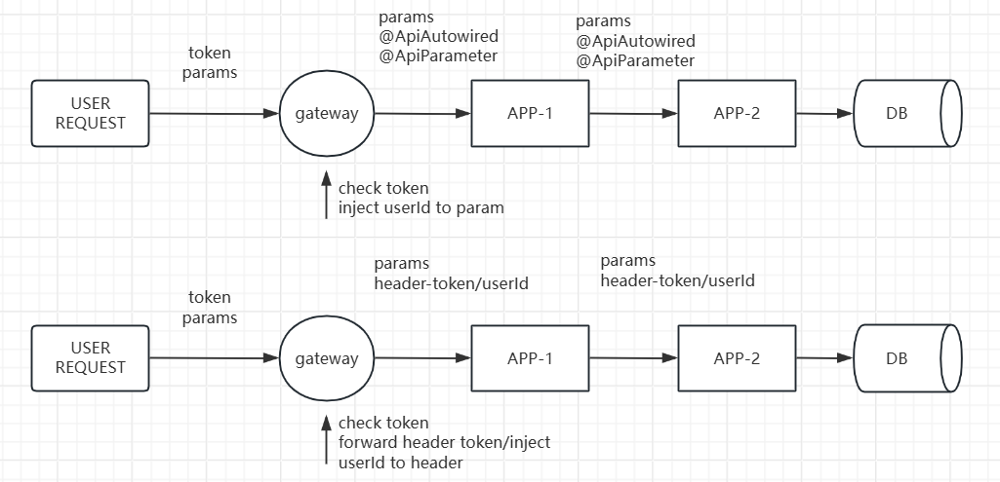
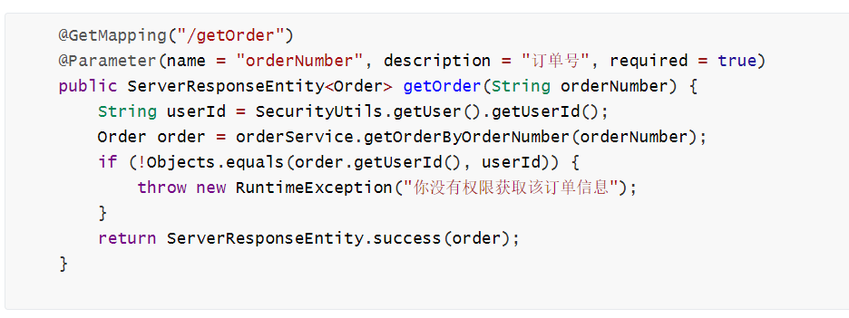
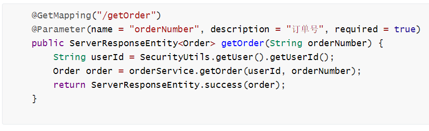
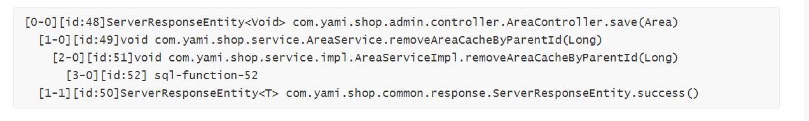

# 基于LLM的水平越权漏洞白盒实践

## 前言

&emsp;&emsp;在大模型应用如火如荼的今天，拥抱AI是是必然选项，无论是管理者还是工程师都会在这一项的构思与实践上迷茫。无论是什么第一性原理、常规思维来看，LLM在安全落地的选择中，黑盒、白盒、运营都是最重要的方向，而25年笔者成功实践并在企业端落地了一款专注于Java应用的水平越权漏洞检测LLMCR工具/项目，从效果来看可谓值得称赞。

&emsp;&emsp;首先，腾讯、字节在年初3月份都有分享它们在大模型白盒上的实践经验，笔者也开始尝试从零开始理解大模型并探索实践LLMCR这个方向，期间的python代码、sast工具都重构了2~3次，项目上追求成果的快速产出与代码快速迭代，同时深入理解业务方的业务代码：一个的工具编写，我们往往习惯于构建`完整可用、逻辑完备`的一套代码，但在这个项目上追求的是成果且各处逻辑不确定（笔者也不清楚到底产出什么、LLM能做到什么），在枯燥的迭代、测试、完善工作过后，笔者最终才产出这一成果，也对LLM应用越权检测这一课题有了深入的理解与研究。

&emsp;&emsp;本文将分享笔者在LLM于水平越权漏洞检测这一课题的思考于实践，在给出实践过程的同时讲述笔者一针见血的认知，希望对大家有所帮助。在本文中，你需要理解”函数过程审计“与”业务审计“这一概念，有这基础概念后才能看懂最终笔者给出的不同模型检测能力的对比。

## 认知漏洞问题

### 为什么选择RLS

>Q：为什么选择水平越权漏洞？
>
>A：目前始终缺乏一款优秀的产品来帮助企业解决越权漏洞问题，这其中的水平越权漏洞在理论上具备可审计性，因此利用大模型来审计此类漏洞是一个非常好的方向。从实践结果来看，没有任何一个漏洞类型在企业端的检测产出效益比得上水平越权漏洞（漏洞的危害、扫描器的实现难度）。

实践上的“投机"，易实现：可暂先搁置context limit问题。

- 上下文：LLM应用都需要考虑到上下文长度限制这一问题，水平越权漏洞中的代码检测逻辑通常在靠前的代码流程中，因此我们限制函数深度也通常不会导致误报，也就是说我们可以粗暴地对函数调用代码做深度限制来避免这一问题。40K上下文通常够用，120K则绰绰有余。
- 底层函数调用截断与污点识别：由于数据操作类型的类/函数名称比较容易识别，即便在底层代码函数调用截断的场景下，外层封装的函数也容易被看着数据操作SINK，也就是说即便

>Q：为何说水平越权漏洞具备可审计性？
>
>A：水平越权漏洞实际上是row-level-security，笔者在下一节具体讲解这个漏洞原理，后续该漏洞就直接简称RLS。

>Q：为何说企业端水平越权漏洞检出效益最高
>
>A：面向普通用户的应用接口，发生RLS影响所有普通用户的数据，而普通用户的数据通常是企业端最重要的数据之一。

### 漏洞概念-什么是RLS


用户接口下，数据围绕用户身份ID产生，数据的查询或更新也需围绕用户的唯一身份，如果相关数据操作没有检查数据所属用户与当前登录用户是否一致则存在水平越权漏洞（row-level security)。

对于一个需要做水平越权限制的接口，其操作的数据的入库必然伴随关于用户身份的唯一ID，因此用户表与数据表存在”外键“这一紧密的联系，问题的本质是用户表与数据表的关系。当然，具体到代码层的逻辑，在审计代码过程中是无法直接了解到相关数据关系的，因此审计代码时更多地是通过代码表意了解可能的ID字段名称，审计是否存在可信的ID字段对不可信的数据进行流程控制，或是作为最终的数据操作时的约束条件。

### 漏洞概念-微服务

企业应用多数为微服务架构，在越权问题场景下我们需要关注微服务问题。这里讨论一下微服务架构及相关问题，由于解决问题的维度是白盒，因此“相关架构分类也只根据代码”。

- 参数流架构：这个架构类似dubbo网关，开发者发布的应用前需要在网关出册接口并标记接口的入参，包括哪些参数是由网关自动注入的（ApiAutowired）、哪些参数是HTTP输入即用户可控的（ApiParamter），在内部调用时也遵循这一原则。
- 边界信任架构：网关验证用户token后将请求发给后台，头部可能携带token或是携带验证后的userId，后续调用内部API同样携带相关头部数据。

&emsp;&emsp;参数流架构下，对于一个数据查询，即便其在第一个APP节点没有做权限校验操作也是可以的，我们只要将所有相关的APP代码审计一遍即可，核心逻辑：一个APP节点的数据操作**必须符合两种情况之一**，其一数据查询函数（DAO/SQL/RPC）传递了可信参数则可以不进行权限校验，其二APP节点的数据操作执行了权限校验则数据查询函数可不传递可信参数。总的来看，参数流架构简直完美契合白盒模式下的RLS问题审计，极大地约束了开发并增强了安全上的可审计性。

&emsp;&emsp;边界信任架构下，我们不知道一个数据操作在哪个APP节点进行了权限校验：由于每个APP节点都是按需取用toekn/userid，因此**APP节点间关于权限校验上是互相黑灯的**，你在APP2上做了校验，但是我在APP1上却无法了解，APP1扫出的就是误报。因此，在这种架构下，企业端的业务的必须要求开发者在DMZ接口即第一个节点就进行权限校验，否则就是灾难性的问题。虽然理论上或许可以串联来分析解决者一问题，但笔者认为这也是“灾难性”地复杂。你可能注意到，笔者将头部userId也划分为“边界信任架构”，虽然它类似参数流架构中动态注入可信的数据，但是在代码层面上却是和“参数流架构”不沾边。



&emsp;&emsp;总结，白盒下的微服务不是问题——参数流架构天然无需解决，边界信任架构应要求业务方在第一层做权限校验，扫描时只关注DMZ接口即可。还好，在笔者接触的业务方中，关键的业务产品都有强制的要求。当然，如果业务部门使用的边界信任架构，但是没有在第一层做权限校验，整个系统混乱，此时最好的做法还是让其统一在第一层做校验，否则一律看作没有校验；而什么串联分析的，在笔者看来完全没有必要，整这么复杂干啥呢，能不能落地、投入精力、怎么维护，随便做点其他事情产出不更好。

## 相关审计要素

水平越权漏洞审计时的要点（query）：

- 污点SINK：即数据操作方法，包括直接的数据操作（SQL/MAPPER/DAO）、间件数据操作（远程调用）。
- 可信的数据：经过认证后的凭证数据或是经过校验后的ID数据。
- 不可信的数据TAINT：来自SOURCE的输入，未经校验前的（经过校验的非ID数据也是不可信）。
- 有效的权限控制方式：
    - 设置ID作为约束项且ID数据可信。
    - 直接获取数据，结果数据包含用户ID，数据返回给用户前校验结果数据所属用户。
    - 多步操作，第一步使用ID作为约束项且ID数据可信，将该ID作为后续的数据操作的入参之一。
    - 多步操作，在多步之后再校验任意步骤之一获取到的ID权限（不包括数据更新操作），校验代码在数据返回用户之前即可。
- 危害判断：根据业务场景与实际危害判断。


DEMO代码展示 “ 数据返回给用户前校验结果数据”：



DEMO代码展示“ID作为数据操作的入参之一”：



## AST工具构建

### 目标

起初的想法很简单，就是想基于源代码层面来输出简单的函数调用图，尝试过joern、soot，最终还是选择直接使用JavaParser，这样效果是最好的，最终实现了快速落地、运行高效。

输入输出
- 输入源码
  - 落地方便：只要源码即可，无需编译操作。
  - 快速：百万行级别的代码单线程下 20分钟~30分钟即可完成AST处理。

- 输出结构化数据，方便大模型理解获取
  - 数据类型：class method sql call-graph
  - 为数据统一分配uid，方便获取


### 实现细节

- 提取入口数据
  - URI路径提取
  - 参数流架构下的参数类型识别，可信参数作为prompt
  - XML文件方式编写入口规则
- 函数调用图
  - 节点类型：函数方法或SQL语句
  - 节点信息： depth index method 
  - 
  - 构建函数调用图：AST工具端只构建函数方法的父子节点关系，函数调用图由扫描器端在使用时构建即可。
- 代码数据详情
  - 函数方法代码：给出 class头代码、class及函数注解、代码行信息
  - 提供出入参的符号解析，能让LLM关联出入参
- SQL语句/接口函数的处理
  - 内置mybatis-plug jar，便于解析相关符号（可选，不解析也没问题）
  - 尽量给到SQL操作语句，对于mybatis-plus自动生成的则无需还原SQL语句（其自动根据ID字段构建，因此是安全的，只需要按检测流程来查看入参情况即可）
- delombok：
  - 原生方式❌：起初尝试魔改lombok的delombok代码来提升效率，但由于此方法涉及到write因此优化上是无用功，在百万行代码项目中只delombok pojo的类也需要delombok1小时以上（做了过滤）。
  - 内存方式✔：只需要在解析AST时手动处理必要的lombok注解动态生成相关方法即可，基本不增加运行时间。

## 构建Agent

&emsp;&emsp;由于代码运行在内网，内网可用的模型在ToolFunction下的能力表现是很差的，即便到了今天（2025/12/31）开源模型下 minimax 的工具调用才表现比较好，但目前最强开源模型笔者认为还是 DeepSeek-V3.2。因此实际上参考Cline来构建底层工具调用是最好的做法，即提示词工具的方式。这样一来我们也无法享受到优秀开源Agent框架，但从原始方式开始也会提升我们对LLM应用的理解。

### 提示词技巧

- 明确的任务步骤：通过结构化指令链引导推理过程。将复杂任务分解为必须依次执行的明确步骤，以此约束LLM的思考路径，减少其自由发挥的空间，从而显著提高输出的可靠性和可重复性。
- 拆分逻辑独立的任务：在复杂的工程任务中，我们可以先人工对任务尽可能进行逻辑上的拆解，通过多个agent执行不同的任务让最终效果更好。当然，实际上这种拆分也存在局限性。
- 状态机获取结果：将任务流程建模为一个有限状态机。为每个步骤定义明确的进入条件和预期输出标准。其中一种情况是，LLM对于专业性较高且复杂的任务，可能会出现推理过程遵循步骤（正确）但最终结论与推理过程不符合的情况，通过状态机将过程与结果绑定可极大避免此类问题。
- 充足的前文知识：LLM在执行任务时，其“记忆力与注意力”是有限的，过多的对话与步骤提供的信息会让LLM任务结果不稳定与不准确。目前来看，在审计任务中，一次性将相关函数代码给出来远比让LLM一步步获取函数代码的效果更好。
- 分离推理与呈现：格式化的输出要求对当前“推理”任务没有帮助，但是会分散LLM的注意力，因此我们可以将此类任务放到后续的提问中。
- 提示词风格与技巧：markdown风格，方便管理且LLM理解很好。可参考Cline等项目。

### 提示词管理

提示词的管理十分重要，方便你不断迭代回归，可以自己编写或使用现有的框架（如POML）。

比如SINK Agent下，设置了system question format，format用于最终的格式化输出，实际上有的agent会设置 question1 question2。

```
- ext
    - tools_call.md
    - function_callgraph.md
    - rules.md
    - ... ...
agent_sink-system.md
agent_sink-question.md
agent_sink-format.md
agent_review-system.md
...

```

通过jinjia2来动态构建提示词，如复用公共的工具说明、根据入参（场景）动态修改提示词。实际上不同数据操作场景提示词会有相应的变化。

```
你是一名代码审计专家... ...
{{ext_tool_call}}
{{ext_funtion_callgraph}}
{{ext_funtion_rules}}


{{dynamic data| to_yaml }}


```

### 工具调用

前文所说的AST格式化输出后，扫描器在构建Agent时提供6种工具给到LLM，并在流式对话中解析工具并进行工具调用。

```
- <get_method_code> [mid] </get_method_code>

- <get_call_graph> [mid] </get_call_graph>

- <completion> <valuable>[true|false]</valuable> <result></result></completion>

- <get_param_cid> [cid]</get_param_cid>
 
- <get_return_cid>[cid]</get_return_cid>
 
- <get_class_code> [cid] <get_class_code>

```


### 构建Agent

#### 整体思路

实际上每个agent的核心提示词都高达大几千的字符，十分复杂。这里对其中的核心思路进行说明。

- 起始输入：任务启动后，提供入口方法代码、末端函数方法代码、函数调用图
- 第一层级获取sink点并调用AST工具自动构建调用链并补充调用链各节点代码行信息
- 第二层级为核心的”函数过程审计“，函数过程审计不进行任何业务场景的判断，只纯粹地检查是否有权限校验操作，对公共接口与敏感接口一视同仁（实际上除了业务人员，安全人员单纯从代码层面很多时候也不好判断接口是否应做权限校验）。
  - control：单纯审计流程控制行为类的代码
  - param：单纯进行代码的入参审计
  - backward：单纯进行出参的审计，判断是否真正造成影响
  - 任何一个函数审计Agent认为漏洞不成立则不再执行后续流程。
- 第三层为具体的业务场景审计，判断漏洞具体影响、是否存在业务危害等。实际处理时还需要结合业务部门相关的接口标记。

```
+--------+     +----------+
|  Sink  | --> | codeline |
+--------+     +----------+
                     |
        +------------+-------------+
        |            |             |
        v            v             v
   +---------+   +--------+   +----------+
   | control |   |  parm  |   | backward |
   +---------+   +--------+   +----------+
        |            |             |
        +------------+-------------+
                     |
                     v
               +------------+
               |  business  |
               +------------+

```


#### 提示词案例

以下是流程审计agent的question2部分提示词，question1要求LLM进行权限校验代码的寻找，question2执行具体的权限校验代码检视工作：

```
====
检视水平权限校验

判断校验代码是否有效：只有当数据进行了有效的数据隔离、从属判断才能避免越权，能有效进行水平权限的数据隔离操作是有效的权限校验。
- 权限校验代码如果与当前调用链污点方法没有数据关系则权限校验无效，因此你需要耐心并细心阅读代码理解它们的数据关系； 
- 对比的逻验的判断：
   - 当两个变量进行比较，如果两个都是不可信的或是用户输入，则权限校验无效；
   - 当两个变量进行比较，只要存在一个是可信的、可靠的，有效的流程中断或数据标记则可以确保权限控制有效。 
- 当你无法获取权限校验函数的代码，如果该函数入参有可信的数据，则该权限校验有效； 
- 对于不可靠的数据的有效校验：将不可靠的数据与可信的数据或是用户登陆后的可信数据进行绑定、关联。 
- 根据水平权限隔离不同用户数据的原则，判断其他情况下的权限校验是否有效。 
- 对于数据查询，在数据输出给用户前的后置的权限校验是有效的。
- 只校验单条数据：如果代码只校验了一组数据中的单条数据，当这组数据的查询条件包含唯一标识字段则该校验操作是有效的。
====

对于调用链末端的污点方法， 请你遵循以下步骤执行本次任务：
1. 为本污点初始化 check_list white_list black_list，格式为 method:xxx.methodName,check_list[],white_list:[],black_list[]；
2. 获取“数据标记工作”标记的数据情况；
3. 对方法的每一个入参进行处理（无论其是否可信）： 判断该入参是否唯一标识字段（如果参数是一个对象，你务必要深入查看该对象的所有字段），请找出所有属于“唯一标识字段”的变量或对象字段并将其加入 check_list ，确保不要遗漏；
4. 如果sink的输入没有唯一标识字段则进行如下检查：
    - 如果入参为不可信的数据，将该入参变量/字段加入black_list。
5. 审计本污点方法前的权限校验代码，执行“检视水平权限校验”，如果 check_list 中的变量经过有效的水平权限校验则将其加入 white_list；
6. 当本污点方法操作类型为 query 时：
    - 执行“检视水平权限校验”（仔细查看方法流程后的代码），在数据输出给用户前如果 check_list 中的变量经过后置的水平权限校验则将其加入 white_list；
7. 检查 check_list 中的变量，对于不在 white_list 且为不可信的变量，将其加入 black_list；
8. 当本方法的数据操作类型是 query 时：
    - 当 white_list 不为空时，将本方法输出的数据标记为可靠的数据PURE。
    - 当 white_list 为空且 black_list 不为空时，将本方法输出的数据标记为不可信的数据。
9. 输出该污点方法的审计结果，格式为 method:xxx.methodName, check_list[...],white_list:[...],black_list[...]。
```


## 不同模型回测结论

在100+个真实样本的回测表现下（漏洞接口与正常接口各一半），DeepSeek-V3.2效果最好。

测试结论首先需要查看”函数审计精确率“情况，只有该值比较高的情况下的检出率有参考价值，否则可能是误报导致检出率比较高。

|                | QwQ-32B  | Qwen3-235B | Deepseek-r1-0528 | QwQ-32B  | Qwen3-235B | Deepseek-r1-0528 |
| -------------- | -------- | ---------- | ---------------- | -------- | ---------- | ---------------- |
| 审计阶段       | 函数审计 | 函数审计   | 函数审计         | 业务审计 | 业务审计   | 业务审计         |
| 函数审计精确率 | 92%      | 92%        | 91%              | /        | /          | /                |
| 准确率         | 64%      | 63%        | 66%              | 76%      | 73%        | 85%              |
| 检出率         | 90%      | 92%        | 83%              | 86%      | 88%        | 82%              |

|                | minimax-m2.1 | DeepSeek-V3.2 | minimax-m2.1 | DeepSeek-V3.2 |
| -------------- | ------------ | ------------- | ------------ | ------------- |
| 审计阶段       | 函数审计     | 函数审计      | 业务审计     | 业务审计      |
| 函数审计精确率 | 85%          | 94            | /            | /             |
| 准确率         | 61%          | 66%           | 79%          | 73%           |
| 检出率         | 94%          | 96%           | 92%          | 92%           |

函数审计精确率：分子分母去掉”越权无危害“的接口。

## 总结

&emsp;&emsp;通过AST工具加工程化Agent的方式，我们可以快速落地一款在水平越权漏洞方面检测效果还不错的工具，在这个实践过程中可以发现此种“提示词工程”方式存在机制上的缺陷。理想方式下应让LLM只处理小片段代码，SAST工具负责数据跟踪，即需要将LLM与强力的SAST数据流分析紧密结合，但这种做法成本还是比较高。目前一个接口在单线程模式下的处理时间约30分钟，10并发下平均3~5分钟，相对来看还是比较耗时的，因此有比较大的改进效益应该只有在数据操作的“递归”逻辑上，即多个数据查询链上的处理，让LLM只做一个数据操作的逻辑判断即可。

&emsp;&emsp;目前实现来看虽然粗略，但无论是从小模型的回测结论与实际业务方的测试结果来看，打个70~80分也是可以的。笔者顺便兼顾了一番前后端开发，页面展示效果也不错，通过后台审计漏洞时还可直接阅读完整的调用链代码（效果比较炫酷也很方便）。

&emsp;&emsp;而大模型在业务判断这块没有一劳永逸的方式，毕竟面对不同业务场景，不是业务方的审计人员人也可能很难直接通过代码判断一个接口是否敏感，合理的方式需要引入其他方式，这也是越权漏洞判断的难点。而有的业务方十分了解自己的接口情况，愿意人工审核“函数审计结果”。
